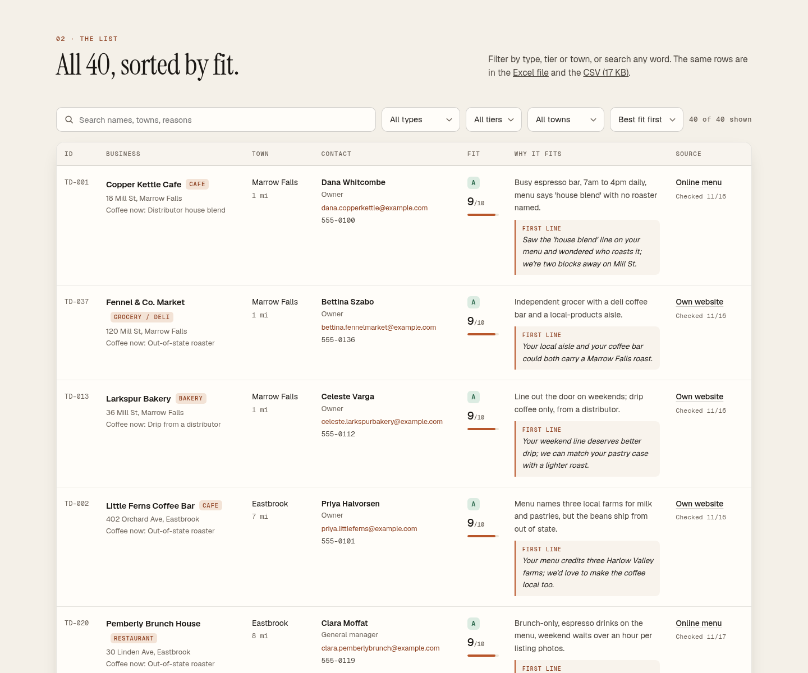

# Thistledown Coffee Roasters: wholesale prospect list

A sample B2B lead list for a made-up coffee roaster that wants wholesale accounts inside its 25-mile delivery loop. It has 40 independent cafes, bakeries, restaurants, offices, gyms and grocers. Each row has a contact name and role, an email (only where the business publishes one) and phone, what coffee they use now, a fit score out of 10 with a tier, one line on why it fits, a suggested first line for outreach, and the source page with the date it was checked.

This is a concept demo. Thistledown Coffee Roasters, Harlow Valley, its towns, and every business, person, address, phone number (555-01xx) and email (example.com) are made up. Source links point to example.com. It is not client work, and no results are claimed.

## View it

Live page: https://alexmercerprojects.com/thistledown-wholesale-prospects/

Or open `docs/index.html` in a browser.

The list is also in `docs/` as an Excel workbook (`Thistledown-wholesale-prospects-DEMO.xlsx`) and a CSV.



## What's in it

- The brief and the six rules a place has to pass to make the list (independent, open, inside the loop, serves or can sell coffee, free to pick a supplier, not already a customer)
- The list: 40 rows you can search, filter by type, tier or town, and sort by fit, distance or name
- Scoring: five parts out of 10, a worked example, and counts by type and town
- Quality checks: every row has a source and a checked date, no guessed emails, 7 duplicates merged and 9 places left off with the rule each one failed
- Handoff: what each workbook tab does and a suggested first week, Tier A grouped by town

## The workbook

| Tab | What it has |
|---|---|
| Read Me | What's in the file and how it was put together |
| Prospects | 40 rows, 27 columns, frozen header, filters, a Status dropdown. Score and tier are formulas over the five score columns. |
| Summary | Counts by type, town and tier with COUNTIFS |
| Scoring | The rubric |
| Skipped | Places left off, with the reason and the rule |
| Duplicates | Duplicates merged and how each was caught |
| Lists | The Status choices |

## Screenshots

- [Desktop](screenshots/desktop.png)
- [Phone](screenshots/mobile.png) and [the list on a phone](screenshots/mobile-list.png)
- [Scoring](screenshots/scoring.png)
- [Quality checks](screenshots/checks.png)
- [Handoff](screenshots/handoff.png)

## How it's built

Plain HTML, CSS and a little vanilla JavaScript in `docs/`. All the rows live in `tools/data.py`. `tools/build.py` works out the scores, tiers and counts from them and writes the page, the CSV and the workbook (openpyxl), so the numbers on the page and in the files always agree.

```
python3 tools/build.py
node tools/shoot.mjs http://localhost:8765/ screenshots/   # optional: screenshots with headless Chrome
```

The page uses Geist, Geist Mono and Instrument Serif, self-hosted and under the SIL Open Font License (see `docs/fonts/LICENSE.txt`). No outside requests.

## Contact

[alexmercer.projects@gmail.com](mailto:alexmercer.projects@gmail.com)
